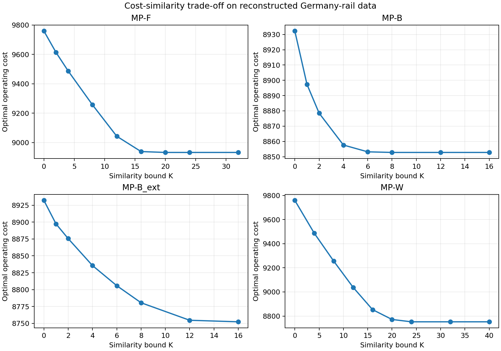
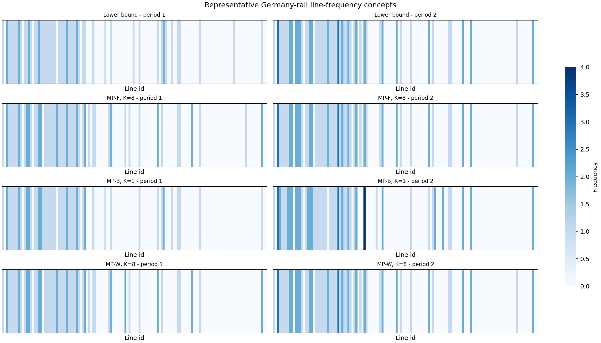

# Reproduction Report: Multi-period Line Planning on Germany-rail

## 1. Scope and conclusion

This repository contains an independent implementation and a compact qualitative
reproduction of Schiewe, Schöbel, and Sieber, *Line Planning for Different Demand
Periods*, Operations Research Forum 4, 92 (2023),
[DOI 10.1007/s43069-023-00268-7](https://doi.org/10.1007/s43069-023-00268-7).

The main qualitative result is reproduced successfully: increasing the allowed
dissimilarity between period-specific line concepts never increases optimal operating
cost, and the models approach different plateaus according to their structural
restrictions. All 44 MILPs in the compact experiment were solved to proven optimality.

This is not a point-for-point numerical reproduction of the paper. The authors' exact
candidate line pools, randomly generated period demands, random seed, and original
implementation are unavailable. The results below must therefore be read as an
independent reconstruction on a traceable public instance from the same LinTim Bahn
family.

## 2. Reconstructed data

The project repository already contained
`src/simulation/data/bahn-01/OD.giv`, a complete 250-by-250 OD matrix. It has:

- 48,842 positive OD pairs;
- total unscaled demand 3,147,382; and
- stop identifiers 1 through 250.

These statistics match the public R1L1 instance in the PESPlib/TimPassLib family.
However, the repository did not contain the corresponding physical network or line
pool.

The missing topology was recovered from the public TimPassLib `long-distance`
instance. Its event-activity network produces exactly 250 stops and 326 unique
undirected drive edges, matching the dimensions reported for Germany-rail in the
paper. The source archive is available from the
[TimPassLib website](https://timpasslib.aalto.fi/), and the downloaded source CSV files
are retained under `datasets/germany-rail/timpasslib/` for traceability.

The reconstruction therefore combines:

1. the public 250-stop/326-edge topology reconstructed from TimPassLib
   `long-distance`; and
2. the repository's existing Bahn-01 OD matrix, whose summary matches R1L1.

This combination is compatible and dimensionally exact, but it is not evidence that
the unpublished experiment files were byte-for-byte identical.

## 3. Line-pool generation

The paper treats the line pool as input and does not state how its four experimental
pools were generated. It cites line-pool generation literature but does not identify an
experiment-specific algorithm or parameter set.

For this reproduction, the pool is generated with a demand-ranked one-shortest-path
augmentation algorithm:

1. Reconstruct the 42 operated lines contained in the TimPassLib event-activity
   network and use them as a geographically meaningful seed pool.
2. Compute deterministic shortest-path trees on the 326-edge network using drive time
   as edge weight.
3. Sort positive OD pairs by decreasing demand.
4. Add each pair's shortest path when it is not already present, treating a path and
   its reverse as the same undirected line.
5. Stop at 132 lines, the smallest line-pool size reported in the paper.

The result contains 132 distinct simple paths with 2 to 32 edges (mean 8.32). The pool
covers all 326 physical edges. This method is a lightweight `k=1` variant of the
shortest-path line-pool approach already supported by LinTim. It was selected because
it is deterministic, inexpensive, demand-aware, and plausible for this software
environment. It is not claimed to be the unpublished method used by the authors.

## 4. Demand periods and costs

Raw R1L1 demand is much larger than a one-hour operational demand. It is normalized
to a nominal total of 5,000 before routing. Each OD pair is assigned to its deterministic
shortest path. Peak edge-frequency lower bounds are then computed as

```text
ceil(normalized edge load / 70 passengers per vehicle).
```

The resulting peak lower bounds range from 0 to 9. Upper frequency bounds are fixed
at 20 for all edges and periods. Keeping upper bounds constant represents operational
capacity rather than demand and ensures that the identical-concept benchmark remains
meaningful.

Two monotone demand periods are generated with seed 2023. For every edge, the first
period's lower bound is a deterministic random fraction between 35% and 65% of the
peak lower bound, rounded upward; the second period equals the peak bound. Thus every
edge's required frequency is nondecreasing between periods.

Line costs follow the LinTim-style affine form

```text
line cost = 50 + 0.05 * total drive time + 0.05 * number of edges.
```

The exact demand and cost parameters used by the paper are not published, so these
choices are controlled reconstruction assumptions.

## 5. Implemented models

The implementation covers all formulations evaluated in the paper:

- **MP-Lower-Bound**: independently optimal line concept for every period.
- **MP-Upper-Bound**: one identical frequency vector for every period.
- **MP-F**: identical active-line sets and an L1 bound on pairwise frequency changes.
- **MP-B**: monotone frequencies and a bound on newly introduced lines between
  consecutive periods.
- **MP-B_iter**: sequential heuristic for MP-B.
- **MP-B_ext**: symmetric-difference bounds without the monotone-frequency
  restriction.
- **MP-W**: transport/Wasserstein line similarity using the paper's length-weighted
  Jaccard distance and unit source/sink penalty.

The models use SciPy's `milp` interface with the open-source HiGHS solver. The paper
used Gurobi 9.5.1, so the runtimes are not directly comparable.

## 6. Experiment

The compact experiment uses two periods and the 132-line pool. The parameter grids
are:

| Model | Tested values of K |
|---|---|
| MP-F | 0, 2, 4, 8, 12, 16, 20, 24, 32 |
| MP-B, MP-B_iter, MP-B_ext | 0, 1, 2, 4, 6, 8, 12, 16 |
| MP-W | 0, 4, 8, 12, 16, 20, 24, 32, 40 |

Together with MP-Lower-Bound and MP-Upper-Bound, this gives 44 solves. All 44
terminated with status `optimal` and zero reported MIP gap.

## 7. Results

The independent-period lower bound is **8,752.25**. Requiring one identical frequency
vector for both periods gives **9,759.50**, an increase of **11.51%**.

| Model | First tested K at best value | Best objective | Gap to lower bound |
|---|---:|---:|---:|
| MP-F | 20 | 8,932.25 | 2.06% |
| MP-B | 8 | 8,852.80 | 1.15% |
| MP-B_iter | 8 | 8,937.85 | 2.12% |
| MP-B_ext | 16 | 8,752.25 | 0.00% |
| MP-W | 24 | 8,752.25 | 0.00% |

Every tested cost curve is monotone nonincreasing in K. The interpretation also agrees
with the paper:

- At K = 0, MP-F and MP-W reproduce the identical-concept upper bound.
- MP-F plateaus above the independent lower bound because it retains a common active
  line set even when the frequency-difference bound stops binding.
- MP-B plateaus above the lower bound because frequencies must remain monotone and
  only new lines are counted.
- MP-B_ext and MP-W reach the independent lower bound once their similarity
  constraints become nonbinding.
- MP-B_iter is much faster than the joint MP-B formulation in this experiment but
  returns a more expensive line concept, reproducing the expected heuristic trade-off.

The absolute K values are not expected to match the paper. K measures frequency units,
new-line counts, or transport cost depending on the model, and the unpublished demand
vectors and candidate pools directly affect the point at which each constraint becomes
nonbinding. The relevant comparison here is the curve shape and limiting behavior.

Recorded solver time over all 44 solves was approximately 7.4 seconds on the current
machine. The largest individual solve took approximately 1.22 seconds. These timings
only characterize this implementation and machine.





## 8. What has and has not been reproduced

Reproduced:

- all paper formulations used in the computational study;
- a Germany-rail-sized PTN with exactly 250 stops and 326 edges;
- a 132-line candidate pool, matching the paper's smallest pool size;
- deterministic monotone multi-period demand;
- the qualitative cost-versus-similarity behavior; and
- the relative behavior of exact and iterative binary-line models.

Not reproduced:

- the paper's exact random demand vectors or seed;
- the authors' four original line pools of sizes 132, 423, 710, and 2,770;
- the exact points in Figures 5–7;
- the runtime-scaling studies in Tables 1–3; or
- Gurobi-specific runtime behavior.

The evidence therefore supports the statement that the reconstruction **broadly
reproduces the paper's effects**, but not that it reproduces the unpublished numerical
instance exactly.

## 9. Reproducibility artifacts

- `results/germany_rail/benchmark.csv`: objective, dissimilarity, runtime, status, and
  MIP gap for every solve.
- `results/germany_rail/frequencies.csv`: every line frequency for every model, K, and
  period.
- `results/germany_rail/summary.json`: experiment and data-generation metadata.
- `results/germany_rail/cost_similarity_tradeoff.png`: compact analogue of the paper's
  cost-versus-similarity figures.
- `results/germany_rail/line_concepts.png`: representative frequency-vector heatmaps.
